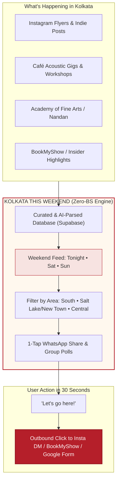
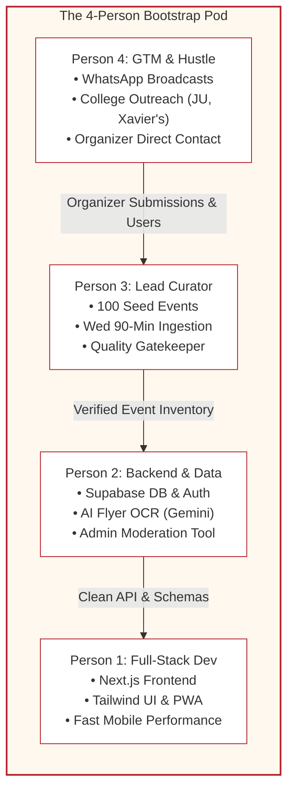
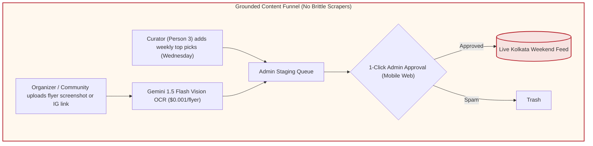
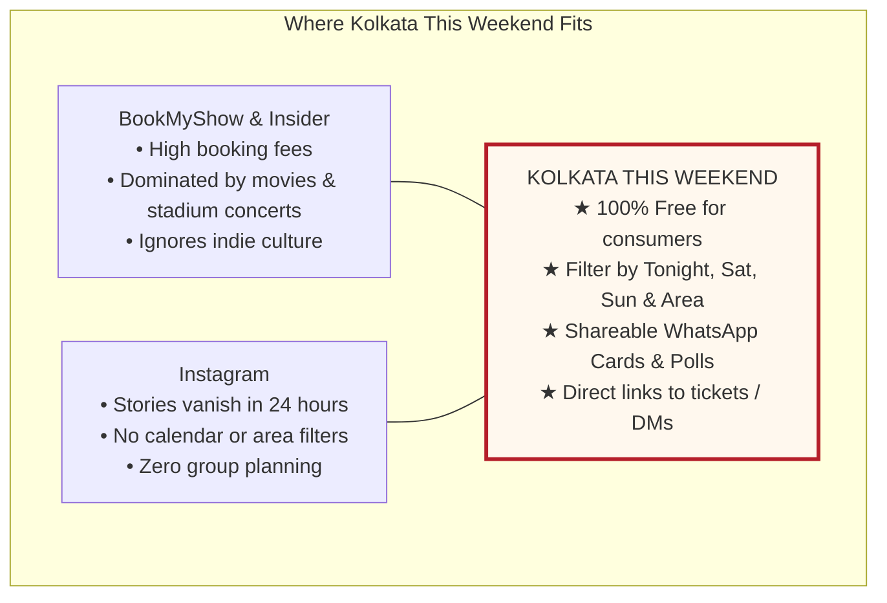

# 01. Product Strategy & Critical Refinement (Bootstrap Edition)

> **Document Version:** 1.2.0 (Bootstrap Edition)  
> **Team Context:** Scrappy 4-Person Founding Crew  
> **Budget:** Near-Zero Infrastructure Burn (Free Tiers + Direct UPI)  
> **Target Launch:** Kolkata, West Bengal  

---

## 1. Executive Vision: The "Kolkata This Weekend" Reality

We are **4 friends** building a focused local product, not a VC-funded bloated corporation. We do not have millions of rupees to burn on marketing, celebrity endorsements, or proprietary ticketing infrastructure.

### The Problem in Kolkata Right Now:
Every Friday afternoon, thousands of people in Kolkata text their friends: *"Kothay jabi bol?"* (Where are we going?).
- **BookMyShow & Insider** only care about ₹1,500+ commercial stadium gigs and movies. They ignore 90% of what makes Kolkata special.
- **Instagram** has the events (live jazz at Skinny Mo's, art workshops at Lake Market, baul evenings, rooftop flea markets, College Street heritage walks), but finding them is painful: flyers get lost in stories, dates are buried in captions, and there is no calendar search.
- **Zomato District** is locked into bookable dining tables and big nightlife transactions.

### Our Job-to-be-Done:
**Kolkata This Weekend** is a fast, beautiful, mobile-friendly weekend feed. It collects what’s happening, structures it by date and area, and lets friends decide and click out to the original organizer or ticketing page.



---

## 2. Realistic 4-Person Team Role Allocation

With 4 people, everyone needs crystal-clear ownership so the team moves at 10x speed without meetings or friction:



---

## 3. Grounded Critique of the Original Concept

### ⚠️ Critique 1: The Scraping Trap
* **Myth:** We will write scrapers to scrape Instagram and BookMyShow automatically.
* **Reality:** Meta will ban our IP within 48 hours. Ticket sites will break our parsers every week.
* **4-Person Solution:** **Tri-Modal Ingestion**:
  1. *Curator Sweep:* Person 3 spends 90 minutes on Wednesday adding 40–50 verified picks.
  2. *AI Flyer Drop-Box:* Organizers upload a poster image or paste a link; Gemini 1.5 Flash parses the text into a draft for 1-click approval.
  3. *Open RSS/Public Calendars:* Cultural bodies with open public dates (Nandan, British Council, Alliance Française).



---

### ⚠️ Critique 2: Spiky 48-Hour Weekend Traffic
* **Myth:** People will check our app all week long.
* **Reality:** Nobody cares about weekend plans on a Tuesday morning. Traffic will be dead Mon–Wed.
* **4-Person Solution:** **Embrace the Spike:**
  - Concentrate all marketing and effort on the **"Thursday 6:00 PM Drop"**.
  - Send the WhatsApp broadcast and post the Instagram Reel on Thursday evening when weekend cravings start.
  - Keep running costs so low that zero traffic on Tuesday costs us ₹0.

```mermaid
journey
    title The Bootstrap Weekly Operating Rhythm
    section Mon - Tue: Quiet Work
      Dev bug fixes & improvements : 5: Devs
      Collect events organically : 4: Curator
    section Wednesday: Content Lock
      Curator reviews & approves 80-120 events : 6: Curator
      Verify tickets & venue addresses : 6: Team
    section Thursday 6 PM: The Drop
      Publish 'This Weekend' feed : 8: Team
      Post Thursday Drop Reel + WhatsApp broadcast : 7: GTM
    section Fri - Sun: Traffic Harvest
      Users browse, vote, and click outbound tickets : 9: Users
      Track outbound clicks & feedback : 8: Team
```

---

### ⚠️ Critique 3: Kolkata Price Sensitivity
* **Myth:** Indie organizers will pay a ₹2,000/month SaaS subscription.
* **Reality:** Kolkata organizers operate on tight margins. They won't buy software.
* **4-Person Solution:** Free to list always. Charge **₹499 one-time boost via direct UPI QR code** when an organizer urgently needs to sell out 15 remaining tickets on Friday afternoon.

---

## 4. Market Positioning: The Local Alternative



---

## 5. Non-Negotiable Bootstrap Rules

1. **Keep Operating Burn Under ₹1,000/Month Initially:** Use Vercel Free, Supabase Free, Cloudflare Free, and GitHub Free.
2. **Never Build Native Apps for MVP:** No iOS/Android app store waiting periods. Mobile-optimized web is 100x easier to share in WhatsApp.
3. **No Heavy Code When Simple Curation Works:** Do not spend 3 weeks building complex scrapers when 1 person with an iced tea can curate 50 great events in 90 minutes.
