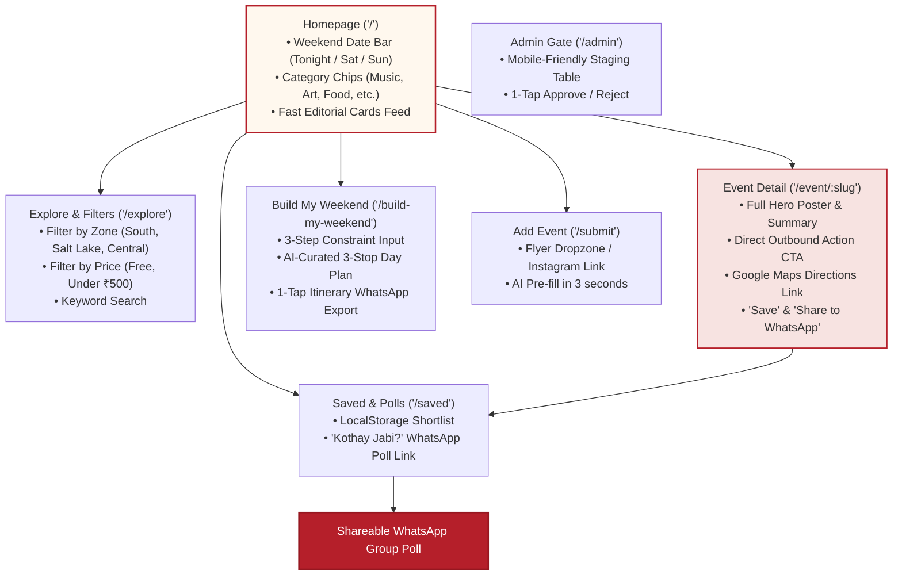
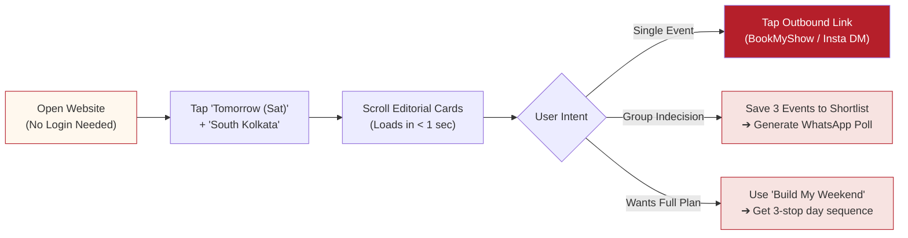
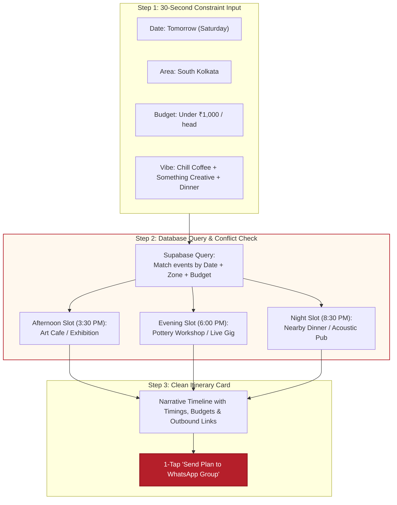
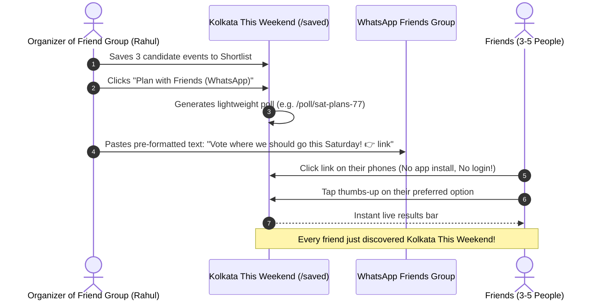
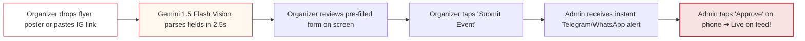

# 02. Feature Specification & UX Architecture (Lean Edition)

> **Document Version:** 1.2.0 (Lean 4-Person Edition)  
> **Status:** Feature Blueprint & Functional Requirements  
> **Principle:** Maximum utility, zero bloat, mobile-first  

---

## 1. Information Architecture & Lean Routes

For a 4-person team, every unnecessary route is technical debt. We keep the application surface lean and laser-focused on weekend conversion:

---

## 2. Core User Journey Flow

---

## 3. Core Feature Breakdown

### 3.1. The Date-Aware Weekend Feed (Homepage)
* **Goal:** Give the user the answer to *"What should I do today/tomorrow?"* within 3 seconds.
* **The Date Strip:**
  - `🔥 Everything This Weekend`
  - `Tonight (From 4 PM)`
  - `Saturday`
  - `Sunday`
  - `Next Weekend`
* **Category Filters:**
  - 🎵 Live Music & Gigs
  - 🎨 Workshops & Art
  - 🎭 Theatre & Cultural
  - 🍽️ Food & Nightlife
  - 🌿 Heritage, Walks & Nature
* **Card Anatomy:**
  - High-res flyer preview (optimized WebP).
  - Category Badge (`🎵 Live Music`).
  - Title, Time & Venue (`Sat • 7:30 PM • Park Street`).
  - Price Tag (`FREE` or `₹299 onwards`).
  - 1-tap Save heart + 1-tap WhatsApp Share.

---

### 3.2. Event Detail Experience (`/event/[slug]`)
* **Goal:** Full context with zero clutter, passing the user cleanly to the source.
* **Sticky Mobile Bottom Bar:**
  - Primary button: Dynamic Outbound CTA (`"Book on BookMyShow ↗"`, `"Register via Google Form ↗"`, or `"DM on Instagram ↗"`).
  - Secondary button: Quick Save heart + WhatsApp share icon.
* **Neighborhood Proximity:**
  - Display coarse location (e.g., *"Hindustan Park, South Kolkata • 4 mins walk from Gariahat"*).
  - Direct *"Open in Google Maps"* link.

---

### 3.3. The Signature Feature: "Build My Weekend"

---

### 3.4. The Viral Growth Engine: "Kothay Jabi?" WhatsApp Poll

This is how our 4-person team gets thousands of users without spending a single rupee on paid ads:

---

### 3.5. Fast Organizer Submission & AI Extraction (`/submit`)

---

### 3.6. Mobile Admin Curation Console (`/admin`)
* **Requirements for a 4-person team:**
  - Must be 100% usable on a mobile phone so Person 3 can approve events while riding the metro.
  - Review queue displays: Poster image, extracted title, date, venue, price, and source link.
  - Buttons: `✅ Approve`, `✏️ Quick Edit`, `❌ Reject`.
