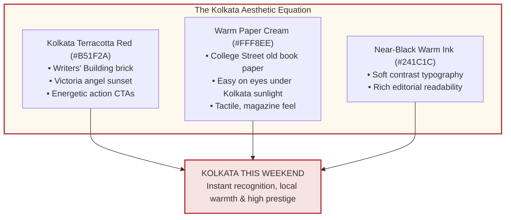
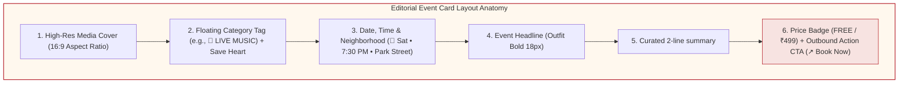
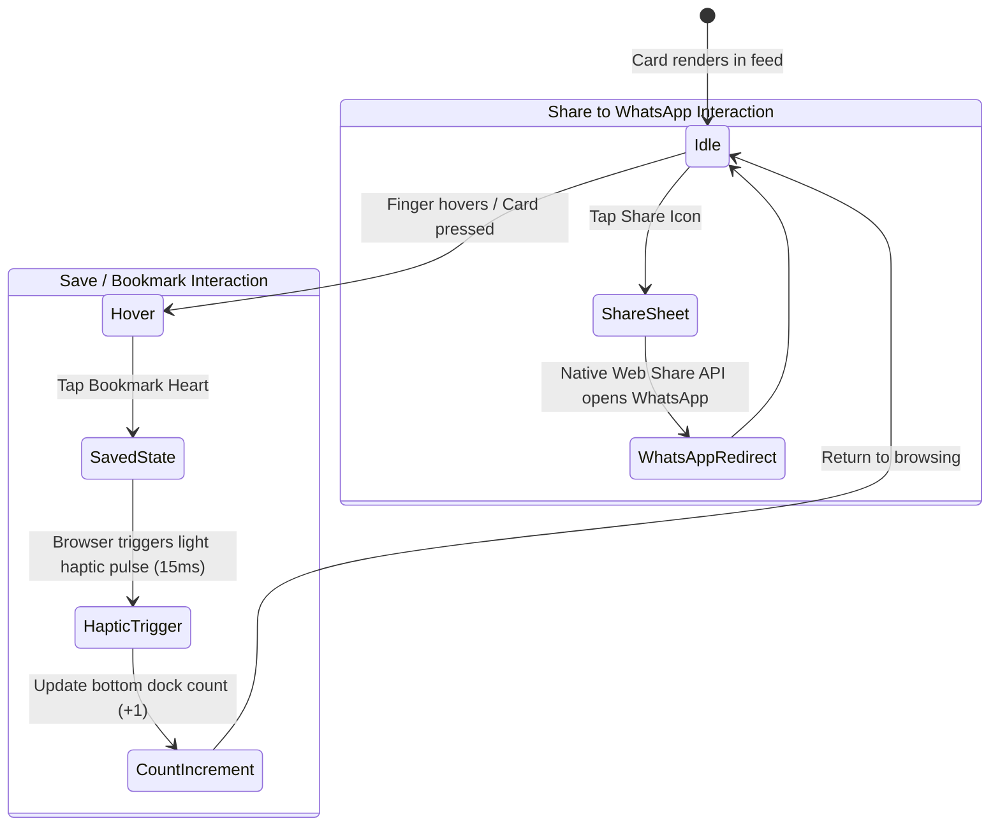

# 03. Design System & Brand Identity (Lean Edition)

> **Document Version:** 1.2.0 (Lean Edition)  
> **Status:** UI/UX Specification & Design Tokens  
> **Theme:** Kolkata Terracotta Red (`#B51F2A`) & Warm Paper Cream (`#FFF8EE`)  

---

## 1. Visual Soul: Warm Editorial Magazine × High-Energy Social

We avoid sterile corporate software styling. The design feels like a warm, beautifully printed city gazette mixed with a modern social feed.



---

## 2. Token Architecture & Component Anatomy



---

## 3. Micro-Interaction State Machine

To make the app feel alive and responsive on mobile devices:



---

## 4. Production CSS Design Tokens

These lightweight CSS tokens are pasted directly into `globals.css` with zero runtime JavaScript overhead:

```css
:root {
  /* Core Brand Colors */
  --brand-red: #B51F2A;          /* Confident Kolkata Red (Primary buttons & badges) */
  --brand-red-hover: #961720;    /* Darkened Red on Tap/Hover */
  --brand-red-light: #F7E3E1;    /* Pale Blush Card Tint */
  --brand-red-subtle: #FDF2F0;   /* Light Red Hover Fill */

  /* Surfaces & Canvas */
  --surface-cream: #FFF8EE;      /* Main Background (Warm Cream White) */
  --surface-card: #FFFFFF;       /* Card Canvas (Clean White) */
  --surface-muted: #F5EFE6;      /* Secondary Container Background */
  --surface-sunken: #EDE5DA;     /* Input fields, border dividers */

  /* Text & Ink */
  --ink-primary: #241C1C;        /* Deep Charcoal Ink (Headings & Titles) */
  --ink-secondary: #5C5252;      /* Slate Gray (Body & Summaries) */
  --ink-muted: #8F8484;          /* Soft Gray (Timestamps & Metadata) */
  --ink-inverse: #FFFFFF;        /* Pure White (Text on Red Buttons) */

  /* Semantic Tags */
  --accent-free: #2B7A4B;        /* Forest Green (Free Entry Badges) */
  --accent-heritage: #D48806;    /* Gold (Heritage & Literature) */
  --border-subtle: #EADFD5;      /* 1px Editorial Border */
}

/* Optional Espresso Night Theme */
[data-theme='dark'] {
  --surface-cream: #141010;      /* Dark Roasted Coffee Canvas */
  --surface-card: #1E1717;       /* Dark Elevated Card Surface */
  --surface-muted: #292020;      /* Dark Secondary Fill */
  --ink-primary: #F5EBE1;        /* Cream White Text */
  --ink-secondary: #B8ADA6;      /* Warm Silver Body */
  --border-subtle: #332727;      /* Subtle Dark Divider */
}
```

---

## 5. Typography Hierarchy

| Style | Font Family | Size (Mobile / Desktop) | Weight | Line Height | Usage |
| :--- | :--- | :--- | :--- | :--- | :--- |
| **Hero Title** | `Outfit` | 32px / 44px | 800 Bold | 1.1 | Homepage Hero ("Everything happening in Kolkata") |
| **Section Header** | `Outfit` | 22px / 26px | 700 Bold | 1.2 | "This Saturday in South Kolkata" |
| **Card Title** | `Plus Jakarta Sans` | 17px / 18px | 700 Bold | 1.3 | Event headline |
| **Body Text** | `Plus Jakarta Sans` | 14px / 15px | 400 Regular | 1.5 | Event description |
| **Meta & Pills** | `Plus Jakarta Sans` | 12px / 13px | 600 SemiBold | 1.3 | Date, Venue, Price tag |
| **Micro Label** | `Plus Jakarta Sans` | 11px | 500 Medium | 1.2 | Source attribution ("Verified from Instagram") |

---

## 6. Mobile Performance Budget

- **Fonts:** Preload only 2 variable Google Font subsets (`Outfit` & `Plus Jakarta Sans`).
- **Card Images:** WebP format, lazy-loaded with a tiny 20px blur placeholder.
- **Zero Heavy Frameworks:** Pure CSS + Radix UI / shadcn headless primitives. Total CSS bundle under **25 KB**.
