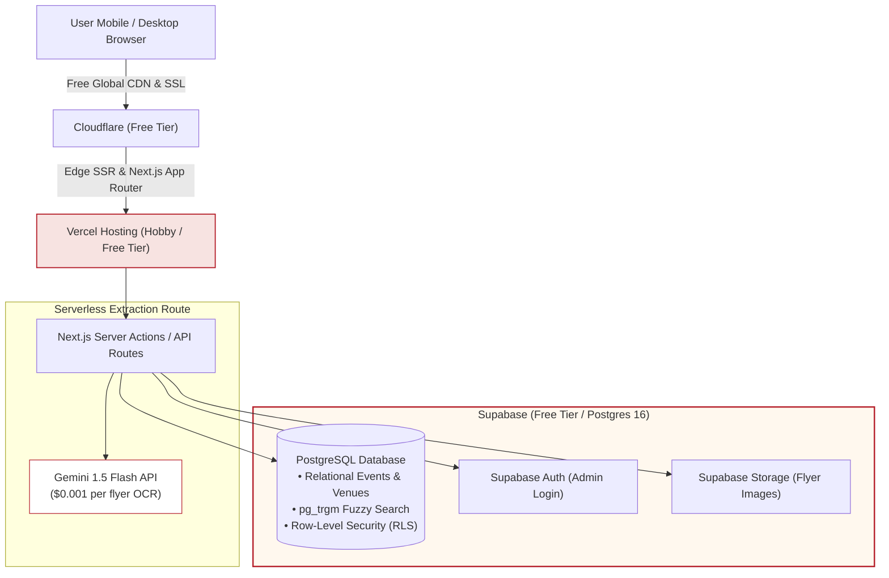
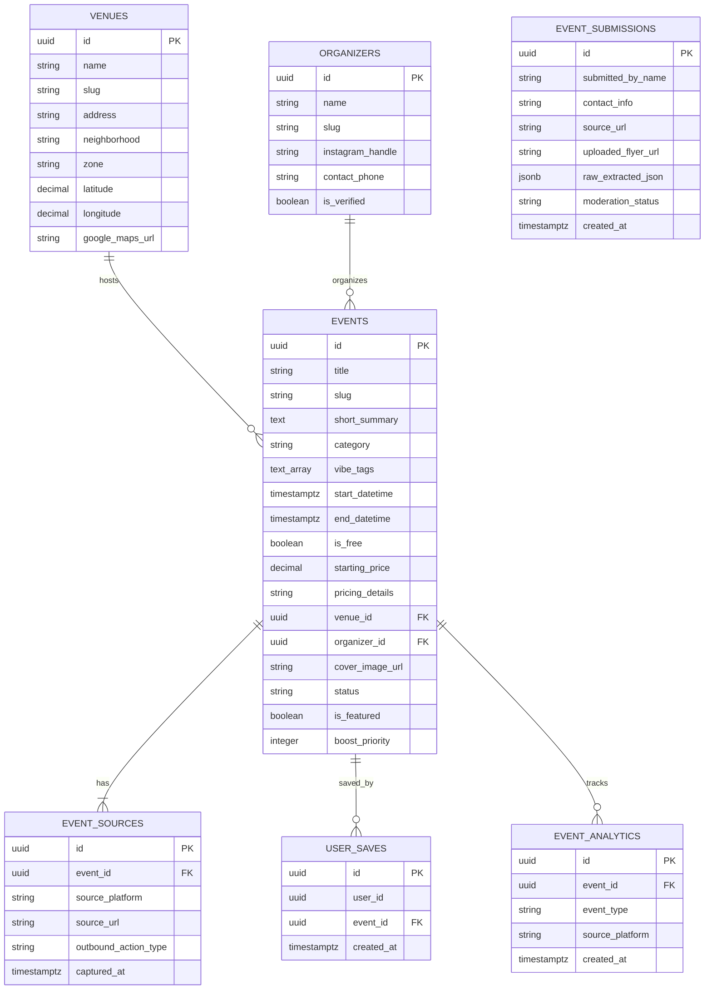
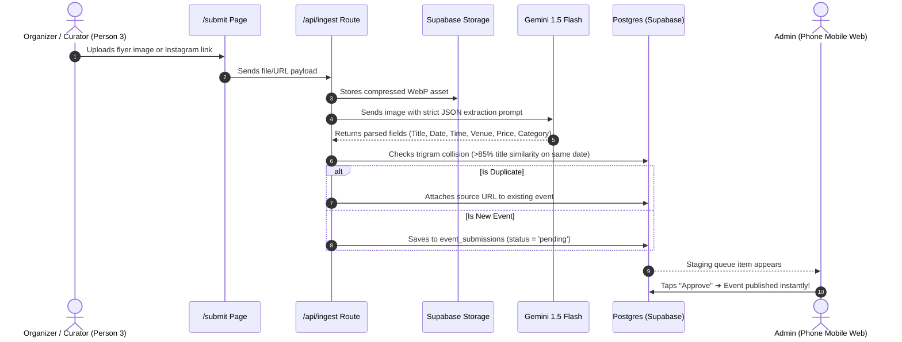
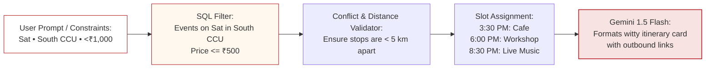

# 04. Technical Stack & System Architecture (Lean Edition)

> **Document Version:** 1.2.0 (Lean Edition)  
> **Target Scale:** Fast MVP Launch (0 to 15,000 WAU)  
> **Hosting Cost Target:** ₹0 to $25/month max (Free Tiers first)  

---

## 1. Grounded Infrastructure Topology

For a 4-person team, we eliminate DevOps overhead completely. No Kubernetes, no standalone Redis clusters to babysit, no microservice fragmentation.



---

## 2. Complete Entity-Relationship Diagram (ERD)

The relational schema cleanly separates canonical events from multiple acquisition sources and enables fast filtering:



---

## 3. Multimodal Ingestion Pipeline



---

## 4. "Build My Weekend" Candidate Resolution Engine



---

## 5. Production PostgreSQL DDL Schema

```sql
-- Enable necessary extensions
CREATE EXTENSION IF NOT EXISTS "uuid-ossp";
CREATE EXTENSION IF NOT EXISTS "pg_trgm";

-- 1. Venues
CREATE TABLE venues (
    id UUID PRIMARY KEY DEFAULT uuid_generate_v4(),
    name VARCHAR(255) NOT NULL,
    slug VARCHAR(255) UNIQUE NOT NULL,
    address TEXT NOT NULL,
    neighborhood VARCHAR(100) NOT NULL, -- 'Park Street', 'Salt Lake', 'Ballygunge', etc.
    zone VARCHAR(50) NOT NULL,          -- 'South', 'Central', 'East', 'North'
    latitude DECIMAL(10, 8),
    longitude DECIMAL(11, 8),
    google_maps_url TEXT,
    created_at TIMESTAMPTZ DEFAULT NOW()
);

-- 2. Organizers
CREATE TABLE organizers (
    id UUID PRIMARY KEY DEFAULT uuid_generate_v4(),
    name VARCHAR(255) NOT NULL,
    slug VARCHAR(255) UNIQUE NOT NULL,
    instagram_handle VARCHAR(100),
    contact_phone VARCHAR(20),
    is_verified BOOLEAN DEFAULT FALSE,
    created_at TIMESTAMPTZ DEFAULT NOW()
);

-- 3. Canonical Events
CREATE TABLE events (
    id UUID PRIMARY KEY DEFAULT uuid_generate_v4(),
    title VARCHAR(255) NOT NULL,
    slug VARCHAR(255) UNIQUE NOT NULL,
    short_summary TEXT NOT NULL,
    full_description TEXT,
    category VARCHAR(50) NOT NULL,      -- 'music', 'workshops', 'theatre', 'food', 'heritage'
    vibe_tags TEXT[] DEFAULT '{}',
    start_datetime TIMESTAMPTZ NOT NULL,
    end_datetime TIMESTAMPTZ,
    is_free BOOLEAN DEFAULT FALSE,
    starting_price DECIMAL(10, 2) DEFAULT 0.00,
    pricing_details VARCHAR(255),
    venue_id UUID REFERENCES venues(id) ON DELETE SET NULL,
    organizer_id UUID REFERENCES organizers(id) ON DELETE SET NULL,
    cover_image_url TEXT NOT NULL,
    status VARCHAR(20) DEFAULT 'published', -- 'draft', 'pending', 'published', 'expired'
    is_featured BOOLEAN DEFAULT FALSE,
    boost_priority INTEGER DEFAULT 0,
    created_at TIMESTAMPTZ DEFAULT NOW()
);

CREATE INDEX idx_events_start_datetime ON events(start_datetime);
CREATE INDEX idx_events_category ON events(category);
CREATE INDEX idx_events_title_trgm ON events USING gin(title gin_trgm_ops);

-- 4. Event Sources (1 Event -> Many Links)
CREATE TABLE event_sources (
    id UUID PRIMARY KEY DEFAULT uuid_generate_v4(),
    event_id UUID NOT NULL REFERENCES events(id) ON DELETE CASCADE,
    source_platform VARCHAR(50) NOT NULL, -- 'instagram', 'bookmyshow', 'insider', 'google_forms'
    source_url TEXT NOT NULL,
    outbound_action_type VARCHAR(50) DEFAULT 'external_ticket',
    captured_at TIMESTAMPTZ DEFAULT NOW()
);

-- 5. Submissions Queue
CREATE TABLE event_submissions (
    id UUID PRIMARY KEY DEFAULT uuid_generate_v4(),
    submitted_by_name VARCHAR(255),
    contact_info VARCHAR(255) NOT NULL,
    source_url TEXT,
    uploaded_flyer_url TEXT,
    raw_extracted_json JSONB,
    moderation_status VARCHAR(20) DEFAULT 'pending',
    created_at TIMESTAMPTZ DEFAULT NOW()
);
```
