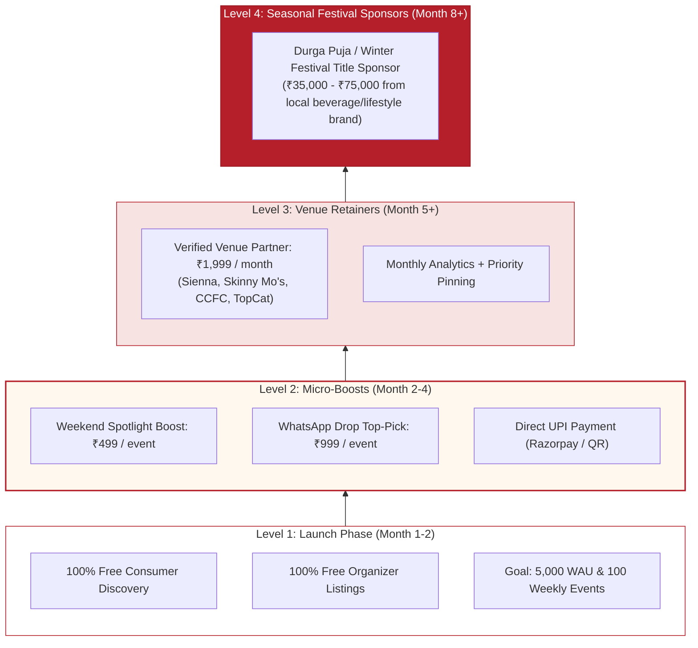
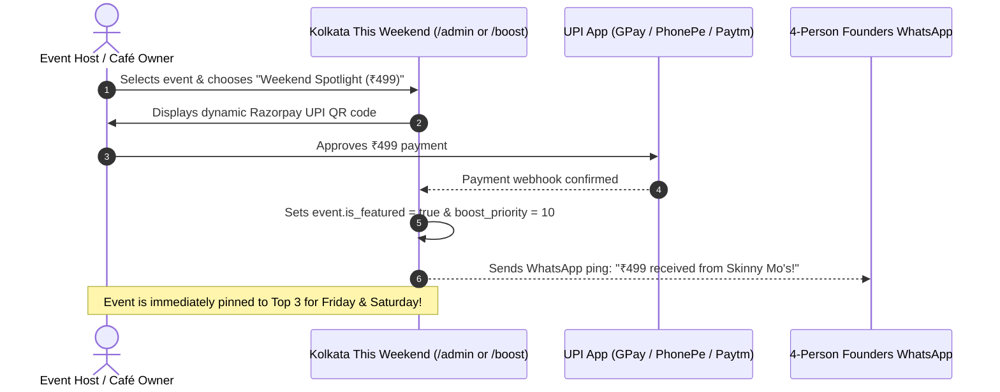

# 05. Monetization Strategy & Business Model (Bootstrap Edition)

> **Document Version:** 1.2.0 (Bootstrap Edition)  
> **Team Context:** 4 Founders, ₹0 Outside Capital  
> **Goal:** Self-Sustaining & Profitable by Month 2  

---

## 1. Grounded Kolkata Reality & Bootstrap Principles

We do not have a venture capital cushion. We cannot wait 3 years to "monetize after scale." But we also cannot charge users or force indie organizers into expensive monthly software subscriptions.

### The 3 Core Rules for Our 4-Person Team:
1. **The Consumer Feed is 100% Free Forever:** Never put up paywalls or consumer subscriptions. Free browsing drives high traffic and word-of-mouth.
2. **Organic Listings are 100% Free for Organizers:** Every legitimate pottery workshop, acoustic gig, and heritage walk can list for free. This guarantees we have 10x more events than BookMyShow.
3. **Monetize Urgent Need via Micro-Boosts & Direct UPI:** When an organizer has 15 unsold tickets on Friday morning, they don't want a software demo—they want people in seats. A ₹499 micro-boost via direct UPI is an instant, no-brainer transaction.

---

## 2. The Bootstrap Monetization Ladder

---

## 3. How Direct UPI Micro-Boosts Work

No complicated invoicing or contracts. Fast self-serve mobile checkout:

---

## 4. Realistic Breakeven & Financial Math

Because our 4-person team relies on free tiers, our monthly fixed operating burn is **almost zero**:

```mermaid
flowchart LR
    subgraph MonthlyCosts["Total Monthly Infrastructure Burn: ~₹850"]
        C1["Vercel Hosting: ₹0 (Free Tier)"]
        C2["Supabase Postgres: ₹0 (Free Tier)"]
        C3["Cloudflare CDN & SSL: ₹0 (Free Tier)"]
        C4["Gemini 1.5 Flash AI OCR: ~₹400 / mo"]
        C5["Domain Maintenance: ~₹450 / mo"]
    end

    subgraph RevenueThreshold["Breakeven: Just 2 Boosts / Month!"]
        R1["2 Boosts @ ₹499 = ₹998"]
    end

    MonthlyCosts --> RevenueThreshold
    RevenueThreshold --> Profit["Every subsequent boost is 95% pure profit split among the 4 founders!"]

    style MonthlyCosts fill:#FFF8EE,stroke:#B51F2A
    style RevenueThreshold fill:#F7E3E1,stroke:#B51F2A,stroke-width:2px
    style Profit fill:#B51F2A,color:#FFFFFF,stroke:#961720
```

---

## 5. 6-Month Realistic Cashflow Forecast for 4 Founders

| Month | Target Traffic (WAU) | Active Boosts (₹499 / ₹999) | Venue Partners (₹1,999/mo) | Total Monthly Revenue | Infra Costs | Net Profit for Founders |
| :--- | :--- | :--- | :--- | :--- | :--- | :--- |
| **Month 1** | 1,500 | 0 (Pure Seeding) | 0 | **₹0** | ₹850 | -₹850 |
| **Month 2** | 3,500 | 6 boosts | 0 | **₹3,994** | ₹850 | **+₹3,144** (Profitable!) |
| **Month 3** | 6,000 | 14 boosts | 2 venues | **₹13,984** | ₹1,200 | **+₹12,784** |
| **Month 4** | 9,000 | 22 boosts | 4 venues | **₹24,974** | ₹1,500 | **+₹23,474** |
| **Month 5** | 12,000 | 32 boosts | 7 venues | **₹39,961** | ₹2,000 | **+₹37,961** |
| **Month 6** | 15,000+ | 45 boosts | 10 venues | **₹58,955** | ₹2,500 | **+₹56,455 / month** |

*Bottom Line:* By Month 6, the product generates **~₹56,000+ net profit per month**, paying for the team's weekend coffee and fueling organic growth without any venture debt.
