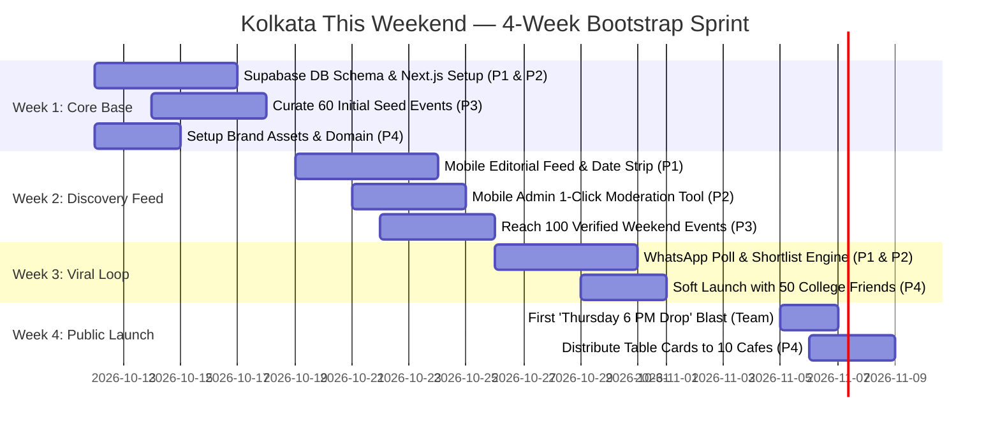
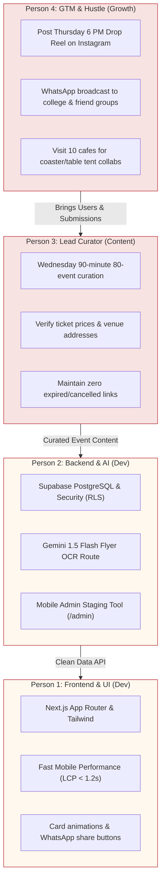
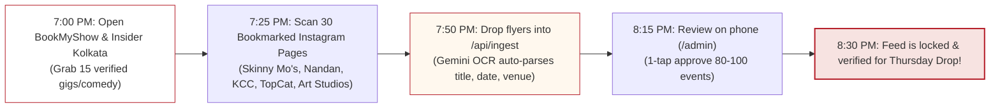
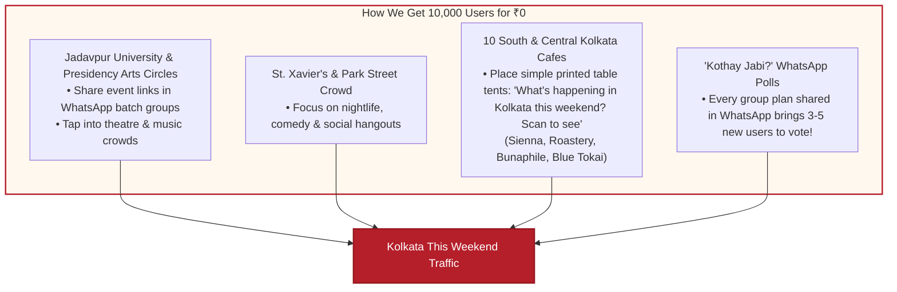

# 06. Execution Roadmap & Go-To-Market Playbook (Bootstrap Edition)

> **Document Version:** 1.2.0 (Lean 4-Person Edition)  
> **Team:** 4 Founders  
> **Target:** Live MVP in 4 Weeks (Zero Bureaucracy)  

---

## 1. The 4-Week Fast MVP Gantt Chart

We do not have months to theorize. We ship a functional, beautiful product in 4 weeks:



---

## 2. The 4-Person Weekly Rhythm & Roles

To prevent confusion and ensure everyone knows what to do every single day:



---

## 3. The 90-Minute Wednesday Content Flywheel

Person 3 doesn't need to spend 20 hours a week curating. Here is the exact, repeatable 90-minute protocol executed every Wednesday evening:



---

## 4. Zero-Budget Hyperlocal Distribution (GTM)

We don't buy Facebook or Google ads. We leverage Kolkata's organic social networks:



---

## 5. North-Star Success Metric & Weekly Checks

```
┌────────────────────────────────────────────────────────┐
│                   THE ONLY METRIC THAT MATTERS         │
│                                                        │
│           Weekly Active Weekend Planners (WAWP)         │
│   (Real people who visit Thursday–Sunday and click a   │
│         Save, WhatsApp Share, or Ticket link)          │
└────────────────────────────────────────────────────────┘
```

### Targets for the 4 Founders

| Timeline | Active Weekly Users | Events in Feed | WhatsApp Polls Created | Outbound Ticket Clicks |
| :--- | :--- | :--- | :--- | :--- |
| **Week 2 (Alpha)** | 100 (Friends & family) | 60 | 10 | 25 |
| **Week 4 (Public Launch)**| 1,200 | 100+ | 80 | 250 |
| **Month 2** | 3,500 | 140+ | 300 | 800 |
| **Month 3** | 6,500 | 180+ | 750 | 1,800 |
| **Month 6** | 15,000+ | 250+ | 2,000+ | 5,000+ |
