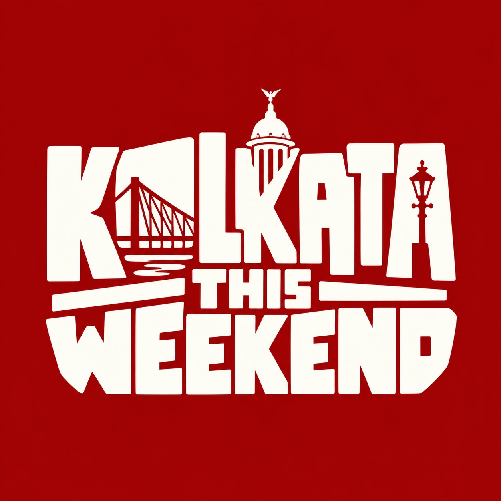

# Kolkata This Weekend (কলকাতা দিস উইকেন্ড) — 4-Person Bootstrap Blueprint

> **"Everything happening in Kolkata, this weekend."**  
> A zero-fluff, city-first discovery engine connecting people with events, indie culture, workshops, nightlife, food, and hidden local experiences. Built to be launched and operated profitably by a **scrappy 4-person team**.

---

## 📚 Master Planning & Architecture Suite

All 6 documents have been tailored specifically for a **4-person founding crew** with **zero VC millions**, using **free infrastructure tiers** (Vercel, Supabase, Cloudflare) and enriched with **rich Mermaid charts and visual flow diagrams**:

| # | Document | Focus Area | Embedded Mermaid Diagrams |
| :-: | :--- | :--- | :--- |
| **01** | [**Product Strategy & Critique**](01_PRODUCT_STRATEGY_AND_CRITIQUE.md) | Vision, Thesis, 4-Person Roles, & Risk Critique | • Bootstrap Value Flow & Discovery Engine • 4-Person Team Role Allocation Pod • Realistic Content Ingestion Flow • Weekly Operating Rhythm (Journey) • Market Positioning Matrix |
| **02** | [**Feature Specification & UX**](02_FEATURE_SPECIFICATION_AND_UX.md) | Routes, User Flows, & Core Mechanics | • Lean Route Architecture Flowchart • Fast 30-Second User Journey • "Build My Weekend" 3-Step Engine • "Kothay Jabi?" WhatsApp Poll Sequence • Fast Ingestion & Mobile Admin Approval |
| **03** | [**Design System & Branding**](03_DESIGN_SYSTEM_AND_BRANDING.md) | Visual Identity, Tokens, & Components | • Kolkata Red & Cream Identity Flow • Editorial Event Card Anatomy Breakdown • Micro-Interaction State Machine (Save / Haptic / Share) • Production CSS Tokens & Typography |
| **04** | [**Tech Stack & Architecture**](04_TECH_STACK_AND_ARCHITECTURE.md) | Engineering, Data Models, & AI | • Lean Zero-Cost Infrastructure Map • **Complete PostgreSQL ERD Diagram** • Ingestion & Vision OCR Sequence • Weekend Route Resolution Pipeline • Production SQL DDL Schema |
| **05** | [**Monetization & Business Model**](05_MONETIZATION_AND_BUSINESS_MODEL.md) | Hyperlocal Economics & Direct UPI | • Bootstrap Monetization Ladder • Direct UPI Micro-Boost Sequence (₹499) • Breakeven Chart (Profitable with 2 boosts/mo) • 6-Month Realistic Cashflow Forecast |
| **06** | [**Execution Roadmap & GTM**](06_EXECUTION_ROADMAP_AND_GO_TO_MARKET.md) | 4-Week Fast MVP & Zero-Budget GTM | • **4-Week Fast MVP Gantt Chart** • 4-Person Daily Roles & Operating Rhythm • 90-Minute Wednesday Curation Flywheel • Zero-Budget Kolkata Distribution Network |

---

## 🎯 4-Person Core Operating Principles

1. **Keep Operating Burn Under ₹1,000/Month:** Use Vercel Free, Supabase Free, Cloudflare Free, and GitHub Free. Never pay for enterprise SaaS when free tiers handle 15,000+ active users.
2. **Clear Ownership Across the 4 Founders:**
   - **Person 1 (Frontend):** Next.js App Router, Tailwind, mobile-first performance.
   - **Person 2 (Backend & AI):** Supabase DB, Gemini flyer extraction, mobile `/admin` tool.
   - **Person 3 (Content & Curation):** Wednesday 90-minute sweep, verifying 80–120 events.
   - **Person 4 (Growth & Hustle):** Thursday Drop Reel, WhatsApp groups, cafe table card distribution.
3. **No Brittle Scrapers:** Instead of fighting Meta IP bans, use a combination of Wednesday curation (Person 3) and direct organizer flyer uploads parsed by Gemini 1.5 Flash.
4. **Monetize via Urgent Micro-Boosts (₹499 Direct UPI):** Don't try to sell ₹2,000/mo SaaS subscriptions to cash-strapped indie hosts. Sell ₹499 one-time boosts to pack venues on Friday and Saturday.
